🍦 Nieves 2048 — Evidencia de Proyecto TDD
Desarrollo Móvil Integral | Práctica de Desarrollo Orientado a Pruebas (TDD) en Flutter.

📌 Resumen del Proyecto
Nieves 2048 es un juego de fusión de fichas inspirado en el clásico 2048 pero tematizado con los tradicionales sabores de nieve de Dolores Hidalgo (desde Vainilla hasta la ficha final de 2048: ¡Independencia!). Todo el motor algorítmico (compactación, fusión en 4 direcciones, validación de victorias y derrotas) está aislado en Dart puro y desarrollado bajo TDD.

🎯 Reglas del Juego y Algoritmo Validadas
- Compactación de Filas: Eliminación de huecos manteniendo el orden de las fichas.
- Fusión Exacta: Combinación de pares iguales adyacentes (evitando fusiones múltiples en una sola jugada).
- Movimiento en 4 Direcciones: Reutilización de la lógica horizontal mediante transposición para manejar Izquierda, Derecha, Arriba y Abajo.
- Inserción Aleatoria Determinista: Generación de fichas nuevas (2 o 4) únicamente cuando un movimiento desplaza fichas de su lugar.
- Control de Estado: Detección automática de victoria al alcanzar 2048 y derrota cuando no hay movimientos posibles.

📸 Evidencias de Ejecución

1. 🧪 Pruebas Unitarias e Integración (`flutter test`)

## Evidencia de TDD (ciclo Rojo → Verde por ronda)

En cada ronda se escribe primero la prueba, se ve fallar (rojo), se implementa lo mínimo para que pase (verde) y después se mejora el código.

### Ronda 1: Compactar una fila
**Rojo:** la prueba falla porque aún no existe `motor_2048.dart`.

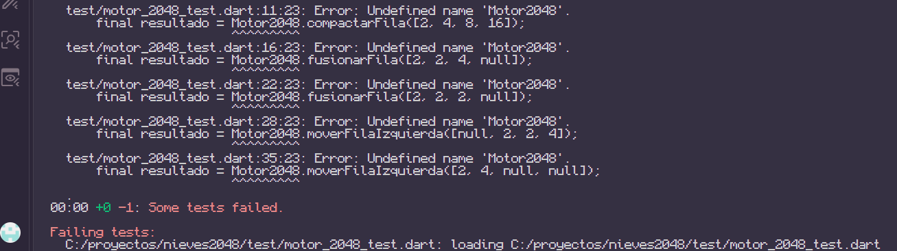

**Verde:** con `compactarFila` implementado, la prueba pasa.

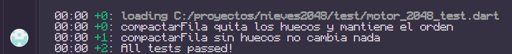

### Ronda 2: Fusionar pares adyacentes iguales
**Rojo:**

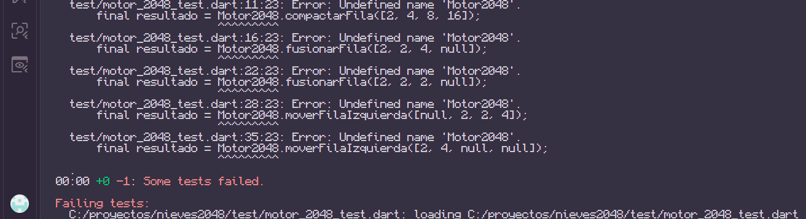

**Verde:**

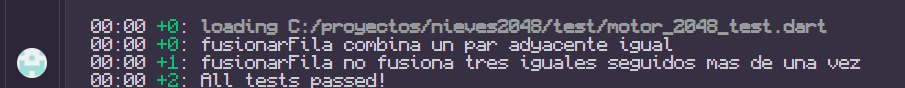

### Ronda 3: Mover una fila completa hacia la izquierda
**Rojo:**

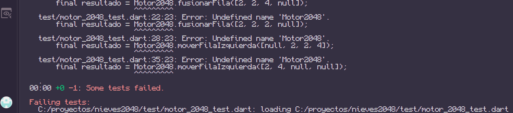

**Verde:**

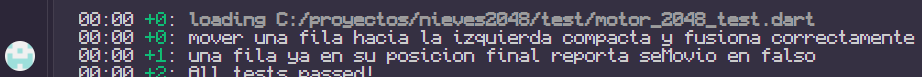

### Ronda 4: Mover la cuadrícula completa hacia la izquierda
**Rojo:**

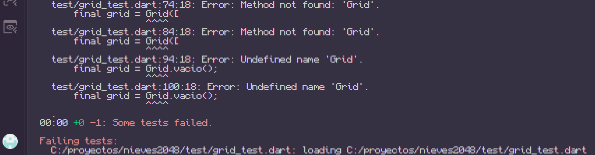

**Verde:**

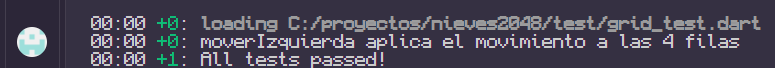

### Ronda 5: Mover hacia la derecha
**Rojo:**

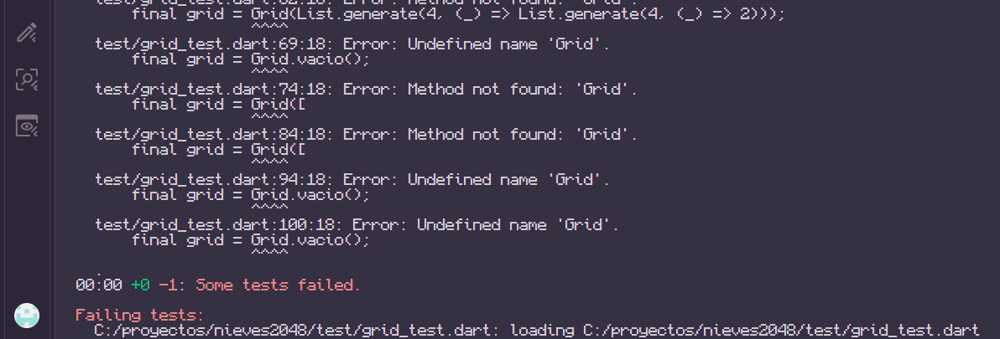

**Verde:**

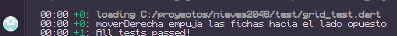

### Ronda 6: Mover arriba y abajo
**Rojo:**

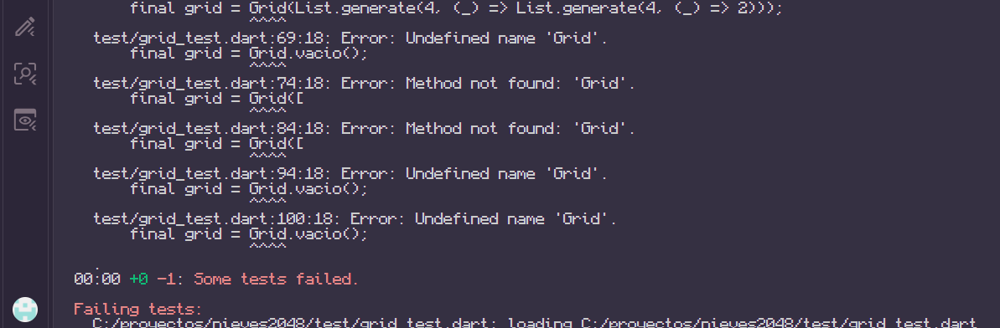

**Verde:**

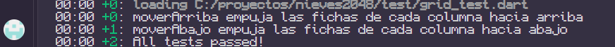

### Ronda 7: Agregar una ficha nueva al azar
**Rojo:**

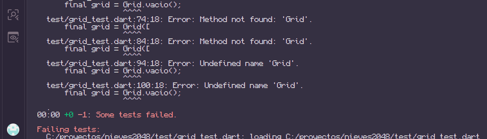

**Verde:**

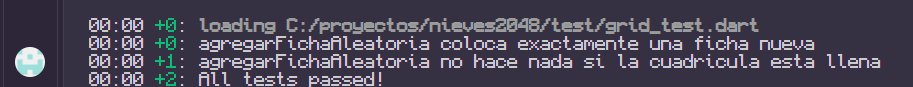

### Ronda 8: Detectar si ya no hay movimientos posibles
**Rojo:**

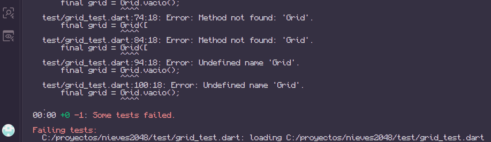

**Verde:**

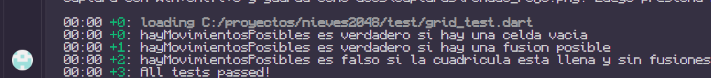

### Ronda 9: Detectar la victoria
**Rojo:**

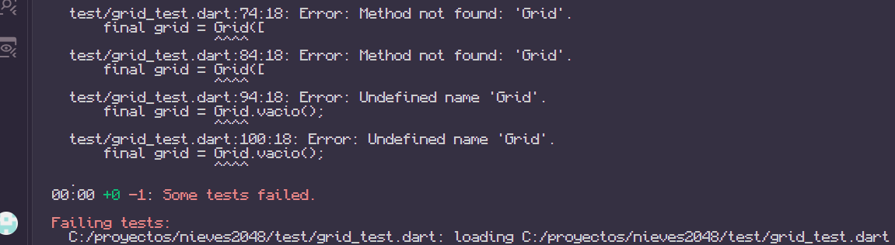

**Verde:**

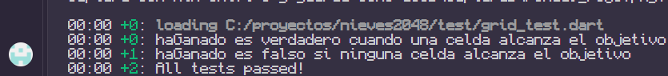

### Ronda 10: MotorJuego (puntaje, turnos, victoria y derrota)
**Rojo:**

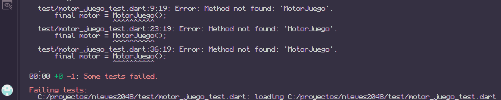

**Verde:**

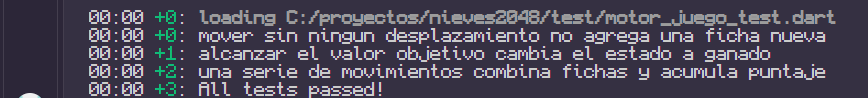

### Resultado final: todas las pruebas pasando
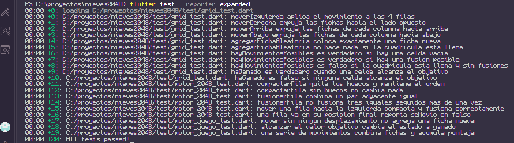

📱 2. Interfaz de Usuario y Animaciones (`flutter run`)

| Tablero Principal (Degradados y Sabores) | Pantalla de Victoria / Fin del Juego |
| :---: | :---: |
|  |  |

